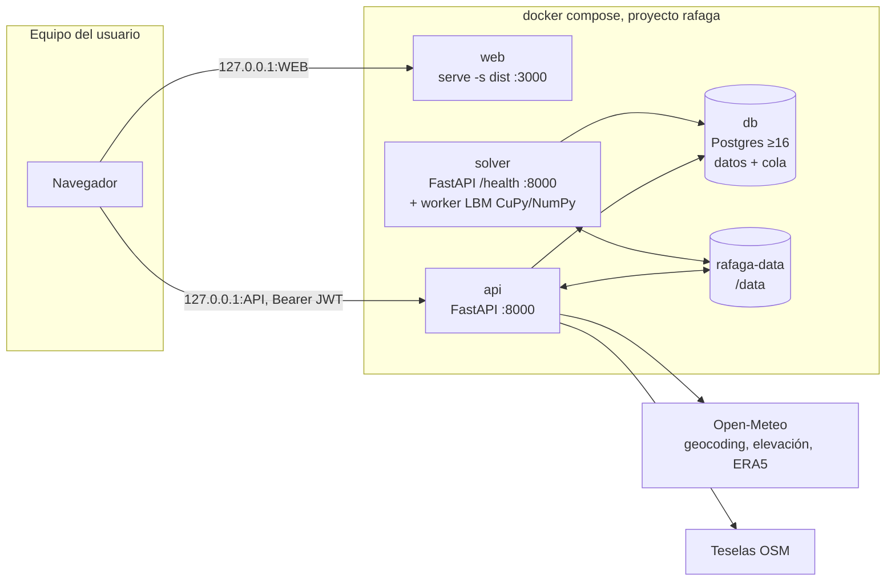

# Ráfaga: arquitectura (Fase 2)

Versión 1.0, 2026-11-13. Fuente de verdad de requisitos: `docs/requirements/handoff.md`.
Este documento explica en prosa el plan legible por máquina `plan.yaml`. Si algo no
coincide, mandan los contratos de `contracts/`, después `plan.yaml` y por último este texto.

| Artefacto | Para quién | Qué fija |
|---|---|---|
| `plan.yaml` | orquestador y todos los agentes | bindings de skills, decisiones, inventario de 162 entregables, imágenes, variables |
| `contracts/openapi.yaml` | WP-API, WP-WEB | 77 operaciones HTTP, esquemas y códigos de error |
| `contracts/scene.schema.json` | WP-API, WP-SOLVER | escena geométrica canónica |
| `contracts/job-contract.md` + `contracts/examples/*.json` | WP-API, WP-SOLVER | tablas compartidas, SQL de la cola, payloads, volumen y formatos |
| `contracts/design-system.md` | WP-WEB | tokens, tipografía, layouts, partículas, copy es-CO |
| `adr/ADR-01..26` | todos | cada decisión con contexto, alternativas rechazadas y consecuencias |

---

## 1. Qué se construye

Ráfaga es una aplicación web local para comparar el viento a nivel peatón (1,5 m por
defecto) entre alternativas de fachada. No depende de ningún lugar: el proyecto nace sin
ubicación y altitud, densidad y clima se derivan siempre de las coordenadas que el usuario
elige (BR-18). No hay proyecto de ejemplo, ni semillas, ni coordenadas por defecto en
código, migraciones o configuración. Las pruebas usan coordenadas sintéticas y respuestas
HTTP grabadas.

## 2. Forma: cuatro servicios



| Servicio | Skill | Es dueño de | No hace |
|---|---|---|---|
| `api` | `fastapi-senior` | usuarios, proyectos, ubicación, clima, geometría (importación, modelo paramétrico, fachadas, validación), escena canónica, mallas, encolado, lectura de resultados, áreas por zona, comparaciones, proxy de Open-Meteo y teselas, migraciones de **todas** las tablas | no simula ni dibuja PNG/PDF |
| `solver` | `fastapi-senior` (solo `GET /health`) | voxelizado, LBM D2Q9/D3Q19, convergencia, posproceso, Lawson, PNG (vista previa y exportación ≥ 300 dpi), PDF, capacidades del dispositivo | no expone más rutas, no habla con internet |
| `web` | `react-senior` + `frontend-design` | SPA, flujo de 6 pasos, editor, mapa, visores, partículas, comparador | no guarda credenciales de terceros; no hace proxy |
| `db` | imagen oficial | almacenamiento y cola (`FOR UPDATE SKIP LOCKED`, `LISTEN/NOTIFY`) | — |
| ops | `engineering-canon` | compose, scripts start/stop/reset, README es | — |

Por qué servicios y no un monolito (ADR-01): el solver necesita ruedas CUDA, ejecuciones de
hasta una hora y aislamiento de fallos; la api debe seguir respondiendo mientras la GPU está
ocupada. No hay Redis, ni OpenFOAM, ni nginx.

## 3. Estructura del repositorio

```
rafaga/
├── compose.yaml                 # WP-OPS
├── compose.gpu.yaml             # WP-OPS (override GPU del solver)
├── .env.example  .gitattributes  .gitignore  README.md
├── start.sh  start.ps1  start.bat
├── stop.sh   stop.ps1   stop.bat
├── reset.sh  reset.ps1  reset.bat
├── scripts/
│   ├── rafaga.sh                # lógica real (start|stop|reset) POSIX
│   ├── rafaga.ps1               # lógica real PowerShell
│   └── smoke.sh                 # prueba de humo extremo a extremo
├── services/
│   ├── api/                     # WP-API, layout fastapi-senior
│   │   ├── app/{configs,core,models,routers,services,repositories,security}/<dominio>/
│   │   ├── alembic/  tests/  Dockerfile  .dockerignore  pyproject.toml  requirements*.txt
│   ├── solver/                  # WP-SOLVER, layout fastapi-senior
│   │   ├── app/routers/health/
│   │   ├── app/services/{queue,device,voxelize,lbm2d,lbm3d,boundary,porous,
│   │   │                 convergence,postprocess,comfort,render,report,bench}/
│   │   ├── app/repositories/{jobs,results,nodes}/
│   │   └── tests/ (validación marcada slow, GPU marcada gpu)  Dockerfile  .dockerignore
│   └── web/                     # WP-WEB, layout react-senior
│       ├── src/{app,api,components,stores,tables,types,hooks,lib,styles,locales,engines}/
│       ├── tests/  docker-entrypoint.sh  serve.json  Dockerfile  .nvmrc  pnpm-lock.yaml
└── docs/
    ├── requirements/handoff.md
    └── architecture/{plan.yaml, architecture.md, contracts/, adr/}
```

Dominios de la api (una carpeta por dominio en cada capa): `auth`, `users`, `projects`,
`shares`, `geo`, `tiles`, `wind`, `geometry`, `imports`, `backgrounds`, `alternatives`,
`facades`, `scene`, `simulations`, `jobs`, `results`, `comparisons`, `exports`, `reports`,
`settings`, `templates`, `system`. Preocupaciones de `security/`: `jwt`, `passwords`,
`ownership`, `rate_limit`.

## 4. Recorrido principal

```mermaid
sequenceDiagram
  participant U as SPA
  participant A as api
  participant D as db
  participant S as solver
  U->>A: PUT /projects/{id}/location {lat, lon}
  A->>A: Open-Meteo elevación (redondeo 4 dec.) + ISA
  U->>A: POST /projects/{id}/wind/era5
  A->>A: ERA5 10 años (clave 0,1°), rosa 16 sectores + Weibull, caché
  U->>A: PUT /projects/{id}/geometry, POST facade-elements
  U->>A: POST /simulations/estimate
  A->>D: lee solver_nodes (VRAM, RAM, MLUPS)
  U->>A: POST /simulations {kind, direcciones, dx}
  A->>A: compila escena + mallas (BR-16, ADR-23)
  A->>D: INSERT study + N jobs (un tx) → NOTIFY rafaga_jobs
  S->>D: UPDATE … FOR UPDATE SKIP LOCKED (reclamar)
  loop cada ~1 s
    S->>D: progreso, fase, ETA; lee cancel_requested
    U->>A: GET /simulations/{id} (sondeo 1 s)
  end
  S->>S: escribe /data/results/... (tmp → rename)
  S->>D: INSERT results + job completed (+ aggregate si fue el último)
  U->>A: GET /results/{id}/fields/K, ux, uy (binario)
  U->>U: mapa K + partículas + zonas en cliente
  U->>A: GET /comparisons/check|areas, POST /exports, POST /reports
```

## 5. Cómo encuentra la SPA a la api (ADR-05)

El problema: los puertos del host los asigna el kernel, las variables `VITE_*` se hornean al
compilar, `serve` no puede hacer proxy y no se admite nginx.

La solución tiene dos partes.

**Puertos estables descubiertos por el kernel.** `compose.yaml` publica
`127.0.0.1:${RAFAGA_WEB_PORT:-0}:3000` y `127.0.0.1:${RAFAGA_API_PORT:-0}:8000`. En el
primer arranque las variables están vacías y el kernel elige puertos libres sin carrera. El
script lee los puertos con `docker compose port web 3000` / `api 8000`, los guarda en `.env`
y repite `docker compose up -d`, que recrea `api` y `web` con `ALLOWED_ORIGINS` y
`RAFAGA_API_PORT` correctos y los mismos puertos. Desde entonces la URL es estable y se puede
guardar en marcadores. Si en un arranque posterior un puerto guardado está ocupado, el script
lo vacía en `.env`, deja que el kernel asigne otro, lo vuelve a guardar e imprime el nuevo
(US-15, escenario de puertos).

**Configuración en tiempo de ejecución.** El `ENTRYPOINT` de `web` escribe
`dist/config.json` con `{"apiPort": <RAFAGA_API_PORT>, "apiBaseUrl": null}` y luego ejecuta
`serve -s dist -l tcp://0.0.0.0:3000`. `serve.json` marca `config.json` como `no-store`. La
SPA lo pide antes de renderizar y construye la base como
`location.protocol + "//" + location.hostname + ":" + apiPort`. Así funciona igual con
`localhost` o con `127.0.0.1`, y la api acepta ambos orígenes. `apiBaseUrl` sirve para
anular la base en instalaciones avanzadas. El bundle no lleva ninguna URL, así que no hace
falta reconstruir al cambiar de puerto. Esta desviación de la regla "VITE_* como build arg"
es intencionada; la propia skill `react-senior` pide pedir en tiempo de ejecución lo que
cambia sin reconstruir.

Se descartaron: `VITE_API_URL` como build arg (reconstruir en cada cambio de puerto), un
proxy inverso (prohibido), que la api sirva la SPA (prohibido), puertos fijos 3000/8000
(chocan) y buscar un puerto libre desde el script (carrera TOCTOU).

## 6. Autenticación, autorización y límites

- **Primer uso**: `GET /auth/setup-status` → la SPA muestra "Crear cuenta local" y bloquea
  las demás rutas. `POST /auth/setup` solo funciona con la tabla `users` vacía, bajo
  `pg_advisory_xact_lock`; después responde 409 `setup_already_done`. Las variables opcionales
  `ADMIN_EMAIL`/`ADMIN_PASSWORD` siembran una cuenta solo si no existe (nunca sobrescriben).
- **Sesión**: argon2id + JWT HS256 (`JWT_SECRET` aleatorio de 64 bytes generado por el
  script, TTL 12 h) en `sessionStorage`, enviado como `Authorization: Bearer`. Sin cookies,
  así que no hay CSRF entre los dos puertos.
- **Rutas públicas**: `/health`, `/api/v1/auth/setup-status`, `/api/v1/auth/setup`,
  `/api/v1/auth/login`. Todo lo demás exige token (prueba estructural de fastapi-senior).
- **Roles**: `architect` (lectura/escritura, gestiona usuarios y comparte proyectos) y
  `reviewer` (solo lectura en proyectos compartidos; escribir o lanzar trabajos da 403).
- **Propiedad**: un proyecto ajeno y no compartido, o cualquier recurso hijo suyo, responde
  404 con cuerpo idéntico byte a byte al de un id inexistente.
- **Límites** (ADR-26): 120/min por dirección antes de autenticar, 600/min por usuario,
  10/min en login/setup, 1500/min para teselas. Los valores salen del sondeo a 1 Hz y de las
  ráfagas de teselas de MapLibre.
- **Imágenes y campos binarios** se piden con `fetch` y el token, y se convierten en blobs u
  object URLs. Nunca va un token en una URL.

## 7. Datos

**Postgres** (migraciones Alembic en la api): `users`, `projects`, `project_shares`,
`geometries`, `uploads`, `background_plans`, `wind_climates`, `external_cache`,
`alternatives`, `facade_elements`, `user_settings`, `templates`, y las tablas compartidas
con el solver (`studies`, `jobs`, `results`, `comfort_results`, `exports`, `reports`,
`solver_nodes`, `schema_meta`). Las compartidas están definidas columna a columna en
`contracts/job-contract.md §2`.

**Volumen `rafaga-data` en `/data`** (api y solver con uid 10001): `uploads/`,
`cache/tiles/`, `results/<project>/<study>/<job>/`, `exports/`, `reports/`. Los campos se
guardan como float32 crudo, para que la api los sirva al navegador sin convertir, más un
`.npz` para descargar (ADR-18). Solo hay volúmenes con nombre; `rafaga-db` es para Postgres.

**Geometría**: el caso base es el conjunto versionado de edificios del proyecto (huella CCW
en metros ENU locales, altura 1–500 m, niveles opcionales). Las alternativas son listas de
elementos de fachada sobre aristas de esos edificios. Si existen alternativas, modificar el
base requiere `confirm_base_change` (BR-09). Los elementos cuya arista desaparece quedan
huérfanos y la escena los omite con un aviso.

**Escena canónica** (ADR-04, `contracts/scene.schema.json`): la api expande cada fachada en
prismas verticales. Los sólidos son edificios, niveles, aletas y marquesinas; los porosos son
celosías, con ζ de Idelchik ya calculado, y vegetación, con LAD y C_d. La escena no contiene
coordenadas geográficas. El solver solo voxeliza. Así 2D y 3D salen del mismo modelo
(FR-34) y ninguna lógica geométrica se duplica.

## 8. Motor de simulación

- **Una sola base de código** (ADR-03): `xp = cupy | numpy`. En GPU, colisión+propagación
  fusionadas en `RawKernel` (objetivo ≥ 400 MLUPS en D3Q19 en una RTX 4060, mínimo
  NFR-02 100). En CPU, NumPy por franjas en un `ThreadPoolExecutor`, porque NumPy libera el
  GIL. Las semillas aleatorias se generan en NumPy y se copian al dispositivo, para que CPU
  y GPU coincidan (≤ 2 % en K medio).
- **Carriles** (ADR-22): `heavy` (1 trabajo, en un proceso hijo con `spawn` para liberar
  siempre la VRAM y poder matarlo) y `light` (2 hilos: Lawson, PNG, PDF). Uvicorn sirve
  `/health` en paralelo.
- **Marco de simulación**: rotado para que el flujo entre por x mínimo. La salida se
  remuestrea a una malla de salida norte-arriba común a todo el proyecto (ADR-23), así ΔK es
  celda a celda y la comparabilidad (BR-11) es comparar `comparability_key`.
- **Física**: la sección 9 resume las preguntas abiertas; el detalle está en ADR-10 a ADR-17.

## 9. Respuestas a las preguntas abiertas

| Pregunta | Respuesta | ADR |
|---|---|---|
| **Q-1** Coarsening en VRAM insuficiente | Memoria = nodos × (104 B en D2Q9; 224 B en D3Q19) + 512 MiB. Presupuesto GPU = 0,85 × VRAM total − 512 MiB; CPU = 0,6 × MemAvailable del cgroup, con tope de 3 M nodos 3D. Si no cabe: dx' = dx·(necesario/presupuesto)^(1/d), redondeado hacia arriba a 0,25 m. Se rechaza si el edificio más estrecho queda con menos de 4 celdas. Ejemplo: 25 M nodos × 224 B = 5,6 GB ≤ 7,2 GB (NFR-02). Máximo en 8 GB ≈ 28,8 M nodos | ADR-10 |
| **Q-2** Convergencia 3D | El tiempo se mide en pasos de flujo FT = nx/u_lat. Arranque de 1,5 FT (2D: 2). Luego se promedia en ventanas, con chequeos cada 0,25 FT del campo medio a z_a. Converge con cambio L2 relativo < 1 % y cambio de |U| medio < 1 % en 3 chequeos seguidos, tras un mínimo de 2 FT. Tope en 6 FT (2D: 8), que termina con `converged=false` y un aviso | ADR-11 |
| **Q-3a** Entrada ABL | Entrada con velocidad regularizada y perfil log desplazado (u*/κ)ln((z+z0)/z0), escalado a u_lat = 0,05 en el techo, con perturbación sembrada del 2 % en 3D (en `volume3d`, sustituida por turbulencia de entrada sintética y techo a 5H, ADR-27). Salida con ρ = 1 regularizada y esponja en el 10 % final. Techo y laterales con deslizamiento libre. Suelo con bounce-back y fuerza de pared logarítmica (Guo) en la primera capa. Edificios con bounce-back a media celda | ADR-12, ADR-20, ADR-27 |
| **Q-3b** Porosidad | Forchheimer con forzado de Guo semi-implícito. Celosía: ζ(β) = ((0,707√(1−β) + 1 − β)/β)², aplicada a la componente normal y repartida en el espesor (β = 0,4 da ζ ≈ 8,23). Vegetación: F = −ρ·C_d·LAD·\|u\|u con C_d = 0,2. Las aletas y marquesinas más finas que dx pasan a celdas porosas con β = 1 − cobertura | ADR-13 |
| Conversión de unidades LBM | u_lat = 0,05 (Ma 0,087 ≤ 0,1), dt = u_lat·dx/U, ν_lat = max(ν·dt/dx², 5e-5), Smagorinsky C_s = 0,17, τ_eff en [0,5005; 2,0]. Se aborta si el Mach local supera 0,35 o aparece un NaN. Se justifica por la independencia del número de Reynolds para aristas vivas | ADR-14 |
| **Q-4** Teselas | OSM raster a través del proxy autenticado de la api, con caché LRU en disco de 500 MB, TTL de al menos 7 días, User-Agent propio y atribución visible. Sin red: lo ya visto, o una rejilla neutra y entrada por coordenadas. El proveedor se configura con `TILE_URL_TEMPLATE` | ADR-09 |
| **Q-5** Lawson LDDC | Excedencia del 5 %: sentarse 4, estar de pie 6, pasear 8, caminar con prisa 10 m/s, incómodo > 10. Seguridad con excedencia del 0,025 %: 15 m/s (personas frágiles, ciclistas) y 20 m/s (público general). U_eff = max(U, GEM) con GEM = U(1+3I)/1,85. Probabilidad con Weibull por sector y transferencia de rugosidad ERA5 → sitio por una altura de mezcla de 60 m. Cobertura renormalizada; resultado "parcial" por debajo del 95 %. La tabla se puede editar | ADR-15 |
| **Q-6** CPU y poca RAM | Mínimo 4 núcleos y 8 GB, solo 2D. Recomendado 16 núcleos y 32 GB para 3D en CPU. Tope de 3 M nodos 3D en CPU, con coarsening automático, y de 1,5 M con menos de 16 GB. El README explica `.wslconfig` | ADR-16 |
| **Q-7** GPU en Windows/WSL2 | Primero `nvidia-smi -L` en el host. Luego un contenedor de prueba (`compose run --rm solver python -m app.services.device.device_probe`) que ejecuta un RawKernel. Si falla, se arranca en CPU con un aviso y un enlace a la guía. CuPy viene de las ruedas `cupy-cuda12x[ctk]` sobre `python:3.12-slim`, sin imagen base de CUDA | ADR-17 |

## 10. Paquetes de trabajo en paralelo

Los cuatro WP arrancan a la vez. Ninguno necesita hablar con otro: todo cruce pasa por un
archivo de `contracts/`.

| WP | Skill | Entregables | Construye contra | Simula al otro lado con |
|---|---|---|---|---|
| **WP-API** | fastapi-senior | 101 (20 ENT, 77 API, 3 JOB, 1 imagen) | `openapi.yaml`, `scene.schema.json`, `job-contract.md` | un "solver falso" en pruebas que escribe `examples/result-manifest.example.json` y los archivos de campos |
| **WP-SOLVER** | fastapi-senior | 21 (1 endpoint, 19 jobs, 1 imagen) | `job-contract.md`, `scene.schema.json`, `examples/job.*.json` | inserta él mismo filas de `jobs` en una BD de pruebas creada con el DDL del contrato |
| **WP-WEB** | react-senior + frontend-design | 29 (23 pantallas, 5 artefactos, 1 imagen) | `openapi.yaml`, `design-system.md` | MSW con los ejemplos de `openapi.yaml` y campos binarios sintéticos |
| **WP-OPS** | engineering-canon | 11 | `plan.yaml` (imágenes, variables, ADR-05/17/25) | imágenes provisionales hasta que lleguen los Dockerfile reales; `smoke.sh` corre al integrar |
| **WP-BACKLOG** | la del componente dueño de cada fila | 11 (BL-01..BL-11) | ADR-27, ADR-28, ADR-29 y los contratos vigentes | cada fila nombra su dueño, su skill y la prueba que la cierra (sección 16) |

Reglas de integración:

1. La api es dueña de las migraciones. Para sus pruebas, el solver crea el esquema mínimo a
   partir del DDL de `job-contract.md §2` y comprueba `schema_meta`.
2. Ambos lados validan contra los mismos `contracts/examples/*.json`. Una prueba de contrato
   en cada WP falla si un ejemplo deja de cumplir su esquema.
3. Los nombres de campo (`K`, `ux`, `uy`, `uz`, `speed`, `ti`, `mask`), las imágenes (`k`,
   `speed`, `zones`, `lawson`) y los códigos de error son los de los contratos; la api los
   valida contra una lista permitida.
4. La integración termina cuando `scripts/smoke.sh` pasa contra `./start.sh`.

## 11. Contenedores y arranque

| Imagen | Base (runtimes.yaml) | Puerto interno | Health | Usuario |
|---|---|---|---|---|
| api | `python:3.12-slim` (host 3.12 ≥ suelo 3.12) | 8000 | `/health` | 10001 |
| solver | `python:3.12-slim` + `cupy-cuda12x[ctk]` | 8000 (no publicado) | `/health` | 10001 |
| web | `node:24-slim` (Node 24 LTS del host) | 3000 | `/` | node |
| db | `postgres:{major}-alpine` (suelo 16, oficial) | 5432 (no publicado) | `pg_isready` | postgres |

Esbozo orientativo de `compose.yaml` (WP-OPS lo concreta):

```yaml
name: rafaga
services:
  db:
    image: postgres:${PG_MAJOR}-alpine        # resuelto por runtimes.yaml, suelo 16
    environment: {POSTGRES_USER: rafaga, POSTGRES_DB: rafaga, POSTGRES_PASSWORD: "${POSTGRES_PASSWORD}"}
    volumes: [rafaga-db:/var/lib/postgresql/data]
    healthcheck: {test: ["CMD-SHELL", "pg_isready -U rafaga"], interval: 5s, retries: 20}
  api:
    build: services/api
    environment:
      DATABASE_URL: postgresql://rafaga:${POSTGRES_PASSWORD}@db:5432/rafaga
      JWT_SECRET: ${JWT_SECRET}
      ALLOWED_ORIGINS: http://localhost:${RAFAGA_WEB_PORT:-0},http://127.0.0.1:${RAFAGA_WEB_PORT:-0}
      DATA_DIR: /data
    volumes: [rafaga-data:/data]
    ports: ["127.0.0.1:${RAFAGA_API_PORT:-0}:8000"]
    depends_on: {db: {condition: service_healthy}}
  solver:
    build: services/solver
    environment: {DATABASE_URL: "postgresql://rafaga:${POSTGRES_PASSWORD}@db:5432/rafaga", DATA_DIR: /data, RAFAGA_DEVICE: "${RAFAGA_DEVICE:-auto}"}
    volumes: [rafaga-data:/data]
    depends_on: {api: {condition: service_healthy}}
  web:
    build: services/web
    environment: {RAFAGA_API_PORT: "${RAFAGA_API_PORT:-0}"}
    ports: ["127.0.0.1:${RAFAGA_WEB_PORT:-0}:3000"]
volumes: {rafaga-db: {}, rafaga-data: {}}
```

`compose.gpu.yaml` solo añade al solver
`deploy.resources.reservations.devices: [{driver: nvidia, count: all, capabilities: [gpu]}]`.

**`start` (Linux y Windows):**

1. Comprueba `docker` y `docker compose` v2. Si faltan, muestra un mensaje con el enlace de
   instalación y sale con código 1.
2. Si no existe `.env`, lo crea a partir de `.env.example` y genera `POSTGRES_PASSWORD` y
   `JWT_SECRET` sin imprimirlos.
3. Si `nvidia-smi -L` funciona, construye y ejecuta la prueba de GPU del solver con el
   override. Si la prueba pasa, usa `compose.gpu.yaml`; si no, sigue en CPU y avisa.
4. Ejecuta `docker compose up -d --build`. Si choca un puerto guardado, lo vacía y reintenta.
5. Si los puertos no estaban guardados, los descubre, los guarda y vuelve a ejecutar `up -d`.
6. Espera a que respondan `/health` de la api y la raíz de web, con 600 s de margen en el
   primer arranque.
7. Imprime "Ráfaga está lista en http://localhost:<puerto>" y el dispositivo, y abre el
   navegador.

`stop` detiene los contenedores sin tocar los datos. `reset` pide escribir "borrar", ejecuta
`down -v` y limpia los puertos guardados (conserva los secretos). `.gitattributes` fuerza LF
en `*.sh` y en `docker-entrypoint.sh`, y CRLF en `*.bat` y `*.ps1`.

## 12. Seguridad, observabilidad y pruebas

- Superficie: solo `127.0.0.1`. Sin telemetría. Las únicas salidas a internet son las
  coordenadas redondeadas, el texto de búsqueda y las coordenadas de teselas (NFR-15). Una
  prueba de lista permitida de destinos lo verifica en la api.
- Subidas: se valida extensión y firma de bytes, se aplica el límite al recibir el flujo
  (100 MB geometría, 25 MB imagen), los parsers tienen tiempo máximo y los nombres de archivo
  los genera el servidor.
- Logs JSON a stdout con `request_id` y `job_id`. `/health` de cada servicio informa la BD y,
  en el solver, el dispositivo.
- Pruebas: pytest (api y solver; `-m slow` para validación y `-m gpu` para GPU), vitest +
  Testing Library + MSW (web), axe en todas las pantallas y en ambos temas, y `smoke.sh` de
  extremo a extremo. Cobertura ≥ 80 % en geometría, viento, escena, voxelizado, posproceso y
  confort (NFR-18).

## 13. Riesgos y supuestos

| Riesgo | Tratamiento |
|---|---|
| NFR-02 (≤ 60 min con 25 M nodos) exige unos 400 MLUPS; con 100 MLUPS serían unas 4 h | kernels fusionados obligatorios. `bench_runner` (SOL-18) mide; si no se alcanza, se renegocia por A-8 (tope de nodos o `max_avg_ft`) |
| 3D en CPU es lento | tope de 3 M nodos, ETA antes de lanzar y recomendación de GPU en la UI |
| GPU en WSL2 | prueba en contenedor antes de usarla; si falla, CPU automático y guía en el README |
| Modelo 2D en planta (sin flujo vertical) | se comunica como cribado; marquesinas por encima de z_a se ignoran en planta con aviso; corte y 3D para validar |
| OSM cambia su política de teselas | proveedor configurable; la caché solo guarda lo ya visto |
| Interpretación como certificación | aviso FR-48 en la UI, en cada PNG y en el pie de cada página del PDF |

Supuestos que este diseño fija: A-2 (rosa a 10 m de ERA5, z0_ref = 0,03 m), A-9 (tabla LDDC
de ADR-15, editable), A-10 (criterio de ADR-11) y A-13 (categorías de BR-08).

## 14. Extensiones al esquema del plan

`plan.yaml` sigue el esquema de `software-architect` y añade, de forma explícita:

- `work_package` en cada fila del inventario, para repartir el trabajo en paralelo.
- `kind: artifact` para entregables que no son pantalla, endpoint, entidad ni trabajo:
  Dockerfiles, compose, scripts, README y motores compartidos del front (19 filas).
- `path` en `skill_bindings`; `published`, `gpu` y `command` en `deployment.images`;
  `compose_overrides` y `volumes` en `deployment`.
- Un componente `db` ligado a `none-official-image` y otro `ops` ligado a
  `engineering-canon`, para que ningún componente quede sin binding.
- `owner` y `skill` en las filas de WP-BACKLOG, porque un mismo paquete toca varios
  componentes y cada fila conserva el binding de su dueño.
- `amended_by` en las decisiones que una ADR posterior enmienda (ADR-03, 10, 12, 17, 25).

No hay `stack_translation`: se construye exactamente lo pedido (FastAPI, React, Postgres,
CuPy/NumPy, LBM).

## 15. Trazabilidad resumida

| Requisito | Entregables |
|---|---|
| FR-01/02, US-01 | API-02..05, SCR-01, SCR-02, JOB-A01 |
| FR-03, US-16 | API-06..08, API-17..19, ENT-03, SCR-22 |
| FR-04/05 | API-10..15, ENT-02, SCR-03 |
| FR-06..10, US-15 | OPS-01..11, IMG-*, ADR-05/17/25 |
| FR-11..19, US-02/06 | API-16, API-20..26, ENT-07/08, SCR-05, SCR-10 |
| FR-20..27, US-03..05 | API-27..35, ENT-04..06, SCR-06..09 |
| FR-28..34, US-07/08 | API-36..45, ENT-09/10, SCR-11, scene.schema.json |
| FR-35..41, US-09/10/18 | API-46..53, SOL-01..11, SOL-15..20, SCR-12, SCR-13, SCR-17 |
| FR-42..49, US-11..13 | API-54..64, SOL-11/12, SCR-14..18, WEB-03/04 |
| FR-50/51, US-14 | API-65..71, SOL-13/14, SCR-19, SCR-20 |
| FR-52..54 | SCR-04, WEB-02, WEB-05, design-system.md |
| FR-55, US-19 | API-74..77, ENT-18, SCR-23 |
| FR-56 | API-47 (`device`), SCR-12 |
| NFR-01..03 | SOL-07/09/18, ADR-10/14/16 |
| NFR-07 | WEB-02, axe en todas las pantallas |
| NFR-12/14/15 | OPS-01/09, security focus, ADR-08/09/18 |
| FR-37, FR-44, C-3 (ráfagas resueltas en 3D) | BL-01, BL-02, ADR-27 |
| NFR-02 (3D en 8 GB) | BL-02, BL-05, ADR-27, ADR-29 |
| NFR-03 (aviso de 3D en CPU) | BL-06, ADR-28 |
| FR-06..08 en Windows | BL-04 |
| BR-10, FR-29 (eficacia de la celosía) | BL-03 |
| FR-51 (PDF), NFR-04 (fluidez) | BL-07, BL-08 |
| Contrato de trabajos | BL-09 (job-contract v1.1) |

## 16. Enmienda posterior a la integración: WP-BACKLOG

Tras integrar los cuatro paquetes quedaron pendientes que no cabían en ninguno. Se agrupan
en `WP-BACKLOG` (`plan.yaml`), donde cada fila declara su componente dueño, la skill que lo
gobierna y una aceptación verificable. Una fila solo se cierra con la prueba o el artefacto
que nombra.

| Id | Dueño | Qué | Decisión |
|---|---|---|---|
| BL-01 | solver | LES 3D con ráfagas resueltas: I_u de 0,15 a 0,30 en campo lejano a z_a, K medio de 0,9 a 1,1, Lawson con `ti` resuelta | ADR-27 |
| BL-02 | api + solver | Techo del dominio 3D en ≈ 5H dentro de 8 GB de VRAM | ADR-27 |
| BL-03 | solver | Una celosía perpendicular al viento reduce K ≥ 10 % en la zona protegida, probado | ADR-13 |
| BL-04 | ops | Scripts de Windows analizados con PSScriptAnalyzer en contenedor y lista de comprobación manual; la ejecución en Windows real la hace el usuario | ADR-25 |
| BL-05 | solver + ops | Imagen del solver ≤ 3 GB y descarga opcional con `RAFAGA_IMAGE_REGISTRY` | ADR-29 |
| BL-06 | api + web | Aviso con ETA y confirmación explícita antes de un 3D en CPU (NFR-03) | ADR-28 |
| BL-07 | solver | Insignia de la flecha de viento en el PDF ≤ 12 % del lado corto del mapa | — |
| BL-08 | web | FPS de las partículas medidos en un navegador real: media ≥ 50 y p5 ≥ 30 a 1080p, con el script en el repositorio | — |
| BL-09 | contratos + solver | `job-contract` v1.1 documenta las columnas de la api que lee el solver (`alternatives.is_base`), con una prueba que lo fija | — |
| BL-10, BL-11 | web | Ubicación por GPS y rosa de puntos cardinales (peticiones del usuario ya registradas) | — |

Cambios de diseño que trae la enmienda:

- **Turbulencia 3D (ADR-27).** La desviación del solver que añadía una longitud de mezcla
  estacionaria en 3D (apartada de C-3) queda sustituida: `volume3d` vuelve a ser LES
  Smagorinsky con turbulencia de entrada sintética, y el techo baja a 5H solo en 3D.
- **Capacidad del dispositivo (ADR-28).** solver → `solver_nodes` → api
  (`/system/status` con bearer y la estimación) → web. No se añaden tablas ni endpoints.
- **Imagen del solver (ADR-29).** Ruedas mínimas de CUDA en lugar de `[ctk]` y registro
  opcional; por defecto se sigue construyendo en local.

