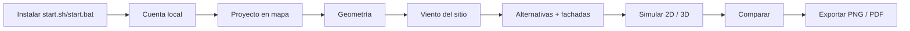

# Ráfaga — Paquete de handoff de requisitos (Fase 1)

Proyecto (slug): `rafaga` · Versión: 1.0 · Fecha: 2026-11-13 · Estado de los requisitos: Approved (decisiones del usuario en el plan "Enmiendas del usuario") · Fuente: requirements-analyst skill

---

## 1. Resumen ejecutivo

**Problema.** Los arquitectos que diseñan fachadas y volúmenes urbanos no tienen una forma rápida, local y comprensible de saber dónde el viento a nivel peatonal (1,5 m) se acelera, se estanca o se reduce, ni de comparar alternativas de fachada (celosías, aletas, marquesinas, retrocesos, vegetación) antes de decidir. Los estudios de túnel de viento o CFD profesional son lentos, costosos y poco iterativos. Origen de la idea: la sensación recurrente de viento fuerte en zonas peatonales de proyectos urbanos reales; el producto es general e independiente de cualquier sitio.

**Solución.** "Ráfaga": aplicación web que corre localmente (Docker, un comando por SO), independiente de la ubicación, con solvers LBM en GPU (CUDA/CuPy) y respaldo automático en CPU (NumPy). Permite ubicar un proyecto en cualquier punto del mapa, cargar o dibujar geometría, obtener el clima de viento del sitio, crear alternativas de fachada, simular en 2D (planta y cortes) y 3D (LBM D3Q19 + LES Smagorinsky), ver zonas de aceleración/estancamiento/reducción, confort de Lawson, comparar alternativas y exportar PNG/PDF.

**Métricas de éxito (KPI).**
- KPI-1: un arquitecto sin formación CFD completa el flujo proyecto → comparación 2D de dos alternativas en ≤ 30 min la primera vez (prueba de usabilidad con ≥ 5 usuarios).
- KPI-2: instalación desde cero a primera pantalla útil en ≤ 15 min (excluye descarga de Docker) en Linux y Windows.
- KPI-3: iteración 2D (caso ≈ 400×300) ≤ 2 min en RTX 4060 y ≤ 10 min en CPU.
- KPI-4: validación documentada: Strouhal 0,13–0,15 (cilindro cuadrado 2D) y recirculación cualitativamente correcta en AIJ caso A (3D).

**Riesgos principales.** (1) Interpretar resultados comparativos como certificación de confort (mitigación: aviso permanente, FR-48). (2) Calidad variable de IFC/DXF importados. (3) Fricción de instalación de GPU en Docker/Windows (WSL2). (4) 3D en CPU puede tardar decenas de minutos a horas. (5) Disponibilidad/limitaciones de la API Open-Meteo (mitigación: caché y entrada manual).

---

## 2. Contexto de negocio

### 2.1 Objetivos de negocio
- BG-1: Reducir el tiempo de evaluación comparativa de viento peatonal de semanas (estudio externo) a minutos/horas, en el escritorio del arquitecto.
- BG-2: Permitir que arquitectos no especialistas tomen decisiones de fachada informadas por zonas de aceleración/estancamiento/reducción.
- BG-3: Herramienta general: funciona en cualquier ubicación del mundo, sin ubicación, coordenadas, altitud, densidad ni clima predefinidos en el código ni en los datos; la app arranca sin ubicación.
- BG-4: Distribución sin fricción: otras personas la ejecutan en su PC con un comando.
- BG-5: Credibilidad científica: solvers validados contra casos de referencia y entregables presentables (300 dpi, PDF).

### 2.2 Actores y registro de interesados

| Actor | Descripción | Experiencia | Influencia / Interés |
|---|---|---|---|
| ACT-1 Arquitecto/Diseñador | Usuario principal: crea proyectos, geometría, alternativas, simula, compara, exporta | Novato en CFD, experto en diseño | Alta / Alta |
| ACT-2 Revisor | Ve solo informes y comparaciones (solo lectura) | Novato | Media / Media |
| ACT-3 Administrador local | La misma persona que instala; ejecuta start/stop/reset, crea la cuenta local | Intermedio | Media / Media |
| ACT-4 Sistemas externos | Open-Meteo (ERA5, elevación), teselas OSM | n/a | n/a |

Decisor: el usuario/propietario del producto (juanhez). Canal: sesión de desarrollo.

### 2.3 Glosario
- **K (factor de amplificación):** K = U / U_ref a 1,5 m de altura, con U_ref velocidad de referencia sin obstáculos a esa altura según el perfil logarítmico.
- **ΔK:** K(alternativa) − K(base), por celda.
- **Aceleración:** K > 1,2. **Estancamiento:** K < 0,3. **Reducción:** ΔK < −0,1.
- **Lawson LDDC:** criterio de confort peatonal (clases por umbral de velocidad y probabilidad de excedencia).
- **Rosa de vientos:** distribución de frecuencia y velocidad por sector direccional (16 sectores).
- **ERA5:** reanálisis climático ECMWF, servido por Open-Meteo.
- **ISA:** atmósfera estándar internacional (densidad del aire vs. altitud).
- **z0:** longitud de rugosidad aerodinámica del terreno.
- **Perfil logarítmico:** U(z) = (u*/κ)·ln(z/z0).
- **LBM D2Q9 / D3Q19:** método de Lattice-Boltzmann (2D / 3D). **LES Smagorinsky:** modelo de turbulencia de submalla.
- **Medio poroso:** zona con resistencia al flujo (celosías, vegetación).
- **Celosía/Screen, Aletas/Fins, Marquesina/Canopy, Retroceso/Setback, Vegetación:** estrategias de fachada.
- **AIJ caso A:** benchmark del Architectural Institute of Japan (edificio 1:1:2).
- **Geocodificación:** búsqueda de lugar por nombre que devuelve coordenadas.

## 3. Estado actual y estado futuro

**Actual.** Intuición del arquitecto o estudios externos de túnel/CFD costosos; herramientas CFD generales con curva de aprendizaje alta; sin comparación visual rápida de alternativas. Línea base de iteración: días a semanas por alternativa (supuesto, ver A-12).

**Futuro (viaje).** Instalar con un comando → crear cuenta local → ubicar proyecto en mapa (altitud, densidad, rosa de vientos automáticas) → geometría (importar/dibujar/calcar) → crear alternativa y añadir fachadas con parámetros por defecto sensatos → simular 2D (minutos) → ver campo de flujo animado y zonas → comparar con deslizador y tabla de áreas → validar en 3D → exportar PNG/PDF.

---

## 4. Alcance

**Dentro del alcance.** Todo lo descrito en las secciones 5–8.

**Fuera del alcance (con justificación).**
- OOS-1: Sustituir un ensayo de túnel de viento o certificar confort/seguridad normativa (herramienta de anteproyecto).
- OOS-2: Cálculo estructural de cargas de viento sobre fachadas/cubiertas (otro dominio y responsabilidad).
- OOS-3: Microclima térmico (radiación, temperatura, humedad, UTCI); solo viento mecánico.
- OOS-4: Dispersión de contaminantes, ventilación interior/natural de edificios.
- OOS-5: Resolución de topografía compleja/terreno 3D (el terreno se modela plano con rugosidad z0; efectos de colinas quedan fuera). Se mostrará aviso si la pendiente local es alta (FR-47).
- OOS-6: Servicio en la nube multiusuario, SaaS, ni acceso remoto por internet; es local.
- OOS-7: Aplicaciones móviles nativas; sin soporte a macOS en MVP (no probado; ver A-5).
- OOS-8: Soporte a GPU AMD/Intel/Apple (solo NVIDIA CUDA; el resto usa CPU).
- OOS-9: Publicación de imágenes en registry (opcional solo si el usuario lo pide).
- OOS-10: Edición completa de modelos BIM/CAD (la edición geométrica se limita a bloques, alturas y elementos de fachada).
- OOS-11: Simulación transitoria/ráfagas con series temporales; se trabaja con estadística de la rosa y estado casi estacionario/promediado.
- OOS-12: Tiempo real de viento (no hay predicción meteorológica; solo climatología histórica).

---

## 5. Historias de usuario y criterios de aceptación

Convención: prioridad MoSCoW entre paréntesis. Las historias se escriben como actor/capacidad/beneficio.

### US-01 Primer arranque y cuenta local (Must)
Como arquitecto, quiero crear una cuenta local la primera vez que abro la app, para que mis proyectos queden privados en mi equipo.
- Escenario: primera ejecución. Dado que no existe ningún usuario, cuando abro la URL, entonces veo la pantalla "Crear cuenta local" y no puedo acceder a otras rutas.
- Escenario: cuenta creada. Dado que completo correo y contraseña válidos (≥ 10 caracteres), cuando envío, entonces entro a la lista de proyectos vacía con el mensaje "Crea tu primer proyecto".
- Escenario negativo: contraseña débil. Cuando envío una contraseña < 10 caracteres, entonces veo un error que indica el mínimo y no se crea la cuenta.
- Escenario: sesión posterior. Dado que existe la cuenta, cuando abro la app sin sesión, entonces veo el inicio de sesión (no el registro).

### US-02 Crear proyecto ubicado en cualquier punto del mapa (Must)
Como arquitecto, quiero colocar mi proyecto en un punto del mapa, buscar un lugar por nombre o escribir coordenadas, para que el clima, altitud y densidad correspondan a mi sitio.
- Escenario: clic en mapa. Dado el mapa, cuando hago clic en un punto, entonces se fijan latitud/longitud (5 decimales) y se muestran la altitud (m) y la densidad ISA (kg/m³) en ≤ 5 s.
- Escenario: búsqueda de lugar. Dado un proyecto nuevo sin ubicación, cuando escribo el nombre de un lugar y elijo un resultado de la geocodificación, entonces el mapa se centra, se fijan latitud/longitud y se obtienen altitud y densidad.
- Escenario: proyecto nuevo sin ubicación. Dado que creo un proyecto, entonces el mapa se muestra sin marcador ni valores precargados y las etapas de viento y simulación permanecen bloqueadas hasta fijar una ubicación.
- Escenario: sin conexión a elevación. Dado que la API falla, cuando intento obtener la altitud, entonces veo un error explicativo y puedo ingresar la altitud manualmente.
- Escenario negativo: coordenadas inválidas (lat fuera de ±90). Entonces se rechaza con mensaje de rango.

### US-03 Importar geometría DXF/STL/OBJ/IFC (Must DXF/STL/OBJ; Should IFC)
Como arquitecto, quiero importar mi modelo, para no redibujar los edificios.
- Escenario: DXF. Dado un DXF con polilíneas cerradas en capas con altura (o atributo de altura), cuando lo importo, entonces aparecen N huellas con su altura y puedo verlas en planta y en 3D.
- Escenario: STL/OBJ. Dado un STL/OBJ en metros, cuando lo importo, entonces se muestra el volumen con su huella proyectada y la unidad detectada/confirmable.
- Escenario: IFC. Dado un IFC con IfcBuilding*, cuando lo importo, entonces se extruye cada elemento a su caja envolvente con altura y recibo un resumen de elementos importados e ignorados.
- Escenario negativo: archivo corrupto o formato no soportado. Entonces recibo un mensaje que explica la causa y cómo corregirlo, sin perder el proyecto.
- Escenario: sin altura. Dado que una huella DXF carece de altura, cuando termina la importación, entonces se marca como "sin altura" y se me pide asignar un valor.

### US-04 Dibujar bloques y asignar altura (Must)
Como arquitecto, quiero dibujar bloques con clic y arrastre y fijar su altura con un control, para modelar rápido con medidas aproximadas.
- Escenario: dibujar. Cuando dibujo un rectángulo/polígono en el lienzo, entonces se crea un bloque con altura por defecto 12 m editable.
- Escenario: editar altura. Cuando muevo el control de altura, entonces el valor numérico se actualiza y el bloque cambia en la vista 3D.
- Escenario: deshacer. Cuando pulso deshacer, entonces se revierte la última operación (≥ 50 niveles).
- Escenario negativo: polígono auto-intersectado. Entonces se advierte y no se acepta hasta corregirlo.

### US-05 Calcar sobre plano imagen/PDF a escala (Should)
Como arquitecto, quiero cargar un plano como fondo y escalarlo, para calcar los volúmenes sobre él.
- Escenario: escalar. Dado un plano cargado, cuando marco dos puntos y digito la distancia real, entonces el fondo se escala y la regla muestra la medida con error ≤ 1 %.
- Escenario: PDF multipágina. Cuando subo un PDF de varias páginas, entonces elijo la página a usar.
- Escenario negativo: imagen demasiado grande (> 25 MB). Entonces recibo el límite y una sugerencia de reducirla.

### US-06 Definir el viento del sitio (Must)
Como arquitecto, quiero obtener la rosa de vientos y definir rugosidad y velocidad de referencia, para simular con el clima real de mi sitio.
- Escenario: ERA5. Dado un proyecto con coordenadas, cuando solicito la rosa, entonces recibo 16 sectores con frecuencia y velocidad (p50, p90, máxima) calculados sobre ≥ 10 años de ERA5, y la respuesta se guarda en caché.
- Escenario: rugosidad. Cuando selecciono una categoría de terreno (p. ej. urbano denso), entonces z0 se rellena con el valor por defecto y puedo editarlo.
- Escenario: manual. Cuando ingreso a mano dirección y velocidad de referencia a 10 m, entonces estas sustituyen a la rosa para la simulación.
- Escenario: densidad. Dada la altitud del proyecto, entonces la densidad se calcula por ISA y se muestra con su fórmula/valor.
- Escenario negativo: sin red y sin caché. Entonces se ofrece la entrada manual con aviso claro.

### US-07 Crear alternativas derivadas del caso base (Must)
Como arquitecto, quiero crear alternativas a partir del caso base, para comparar estrategias sin perder el original.
- Escenario: duplicar. Cuando creo una alternativa, entonces hereda geometría y viento del caso base y el caso base queda inmutable.
- Escenario: nombre. Cuando renombro la alternativa, entonces el nombre aparece en comparador y reportes.
- Escenario negativo: límite. Dado que ya hay 8 alternativas, cuando creo otra, entonces recibo un aviso de límite configurable.

### US-08 Añadir estrategias de fachada con parámetros (Must)
Como arquitecto, quiero seleccionar una arista y aplicar una estrategia (celosía porosa, aletas/quiebravientos, marquesina/voladizo, retroceso, vegetación), para probar cómo reducen el viento.
- Escenario: celosía. Cuando elijo "Celosía" en una arista, entonces puedo fijar porosidad (0–100 %, defecto 40 %) y altura, y se visualiza en el lienzo.
- Escenario: aletas. Cuando elijo "Aletas", entonces fijo profundidad (defecto 0,5 m) y paso (defecto 1,0 m).
- Escenario: marquesina. Cuando elijo "Marquesina", entonces fijo vuelo (defecto 2,0 m) y altura (defecto 3,5 m).
- Escenario: retroceso. Cuando elijo "Retroceso", entonces fijo el retroceso por piso (defecto 1,0 m).
- Escenario: vegetación. Cuando elijo "Vegetación", entonces fijo densidad de área foliar (LAD, defecto 1,0 m²/m³) y altura (defecto 8 m).
- Escenario negativo: parámetro fuera de rango. Entonces se corrige al límite más cercano con mensaje explicativo.
- Escenario: estado vacío. Dado un proyecto sin edificios, cuando intento aplicar una fachada, entonces veo "Dibuja o carga tu primer edificio".

### US-09 Simular 2D en planta y cortes verticales (Must)
Como arquitecto, quiero simular en 2D a 1,5 m y en cortes verticales, para iterar rápido por varias direcciones.
- Escenario: planta. Cuando lanzo una simulación 2D para la dirección E con una alternativa, entonces obtengo el campo K a 1,5 m y recibo avance visible hasta terminar.
- Escenario: multi-dirección. Cuando selecciono N direcciones (hasta 16), entonces se encolan N trabajos y los resultados se agregan por la rosa.
- Escenario: corte vertical. Cuando trazo una línea de corte, entonces obtengo el campo de velocidad en ese plano vertical.
- Escenario: GPU/CPU. Dado que no hay GPU NVIDIA, cuando lanzo, entonces el solver usa CPU y la interfaz muestra "CPU" como dispositivo.
- Escenario negativo: caso demasiado grande. Dada una malla que supera la memoria disponible, entonces el trabajo se rechaza al validar, con sugerencia de aumentar el tamaño de celda.
- Escenario: cancelar. Cuando cancelo un trabajo en curso, entonces se detiene en ≤ 10 s y queda marcado "cancelado".

### US-10 Simular 3D en GPU (Must)
Como arquitecto, quiero validar una alternativa en 3D, para confirmar el comportamiento que muestra el 2D.
- Escenario: lanzar. Dada una alternativa con geometría válida, cuando lanzo 3D, entonces el trabajo corre en segundo plano con barra de progreso, tiempo estimado restante y dispositivo.
- Escenario: porosidad 3D. Dada una celosía o vegetación, entonces se modela como zona porosa también en 3D.
- Escenario: resultados. Cuando termina, entonces puedo ver el corte a 1,5 m (K) y un visor 3D navegable.
- Escenario negativo: VRAM insuficiente. Dado que la malla excede ≈ 28 M nodos en 8 GB, entonces el sistema propone coarsening automático o rechaza con explicación.
- Escenario: persistencia. Cuando recargo la página durante un trabajo, entonces el progreso se recupera.

### US-11 Ver zonas de aceleración, estancamiento y reducción (Must)
Como arquitecto, quiero ver mapas con zonas coloreadas y leyenda numérica, para identificar los puntos críticos.
- Escenario: zonas. Dado un resultado, cuando activo "Zonas", entonces se resaltan K > 1,2 (aceleración), K < 0,3 (estancamiento) y, si hay base, ΔK < −0,1 (reducción).
- Escenario: umbrales. Cuando cambio un umbral en ajustes, entonces las zonas y el área se recalculan sin re-simular.
- Escenario: campo animado. Cuando abro resultados, entonces veo partículas animadas sobre la planta; con `prefers-reduced-motion` la animación se desactiva y se muestra un campo estático.
- Escenario: leyenda. Entonces cada mapa incluye leyenda numérica con unidades.

### US-12 Confort de Lawson ponderado por rosa de vientos (Must)
Como arquitecto, quiero ver clases de confort Lawson por zona, para entender qué usos peatonales son adecuados.
- Escenario: cálculo. Dados resultados en N direcciones y la rosa del sitio, cuando pido confort, entonces cada celda recibe una clase LDDC según su probabilidad de excedencia ponderada.
- Escenario: incompleto. Si faltan direcciones, entonces la interfaz muestra la cobertura de la rosa (% de frecuencia simulada) y marca el resultado como parcial.
- Escenario: explicación. Cuando selecciono una clase, entonces veo una nota interpretativa en lenguaje sencillo.

### US-13 Comparar alternativas (Must)
Como arquitecto, quiero comparar alternativas con deslizador, mapa ΔK y tabla de áreas, para decidir cuál reduce más el viento.
- Escenario: deslizador. Cuando selecciono dos alternativas, entonces veo el antes/después con un deslizador arrastrable con teclado (flechas).
- Escenario: ΔK. Cuando activo ΔK, entonces veo el mapa divergente con ΔK < −0,1 marcado como reducción.
- Escenario: tabla. Entonces veo el área (m²) y el porcentaje por zona (aceleración, estancamiento, reducción) y por clase de Lawson, para cada alternativa.
- Escenario negativo: simulaciones incompatibles (distinta dirección/resolución/dispositivo no relevante). Entonces se bloquea la comparación y se explica qué difiere.

### US-14 Exportar PNG y PDF (Must)
Como arquitecto, quiero exportar imágenes y un informe, para presentarlos al cliente.
- Escenario: PNG. Cuando exporto un mapa, entonces recibo un PNG a ≥ 300 dpi con leyenda, escala, norte y viento de referencia.
- Escenario: PDF. Cuando genero el informe, entonces incluye datos del proyecto, ubicación, rosa, parámetros, mapas, tabla de áreas, Lawson y el aviso de limitaciones.
- Escenario: accesibilidad del color. Entonces los mapas usan paletas perceptuales (cmocean) y las zonas son distinguibles sin color (patrón/etiqueta).
- Escenario negativo: sin resultados. Entonces exportar está deshabilitado con explicación.

### US-15 Instalar con un comando (Must)
Como persona con Docker, quiero ejecutar un solo comando en mi SO, para tener la app funcionando sin configuración manual.
- Escenario: Linux. Dado Docker Engine, cuando ejecuto `./start.sh`, entonces se comprueba Docker, se detecta GPU, se levanta todo, se espera /health y se abre el navegador con la URL.
- Escenario: Windows. Dado Docker Desktop con WSL2, cuando ejecuto `start.bat` o `start.ps1`, entonces ocurre lo mismo.
- Escenario: GPU. Dado `nvidia-smi` operativo, entonces se aplica la configuración GPU automáticamente y la UI indica "GPU: <modelo>".
- Escenario: sin GPU. Entonces arranca con CPU sin errores y la UI indica "CPU".
- Escenario negativo: Docker ausente. Entonces el script termina con mensaje claro y el enlace de instalación.
- Escenario: puertos. Dado un puerto ocupado, entonces se asigna otro y se imprime el efectivo.
- Escenario: comandos stop y reset. `stop` detiene sin borrar datos; `reset` pide confirmación y borra volúmenes.

### US-16 Gestionar proyectos y compartir informes con un revisor (Should)
Como arquitecto, quiero listar, duplicar, eliminar proyectos y dar acceso de solo lectura a un revisor, para organizar mi trabajo y recibir comentarios.
- Escenario: revisor. Cuando creo un usuario revisor, entonces solo ve proyectos asignados, resultados y exportaciones, sin poder editar ni lanzar trabajos.
- Escenario: duplicar y eliminar con confirmación.
- Escenario negativo: el revisor intenta lanzar una simulación y recibe 403 con mensaje claro.

### US-17 Ayuda guiada y aviso de limitaciones (Should)
Como arquitecto novato, quiero valores por defecto, ayudas en contexto y un aviso claro, para usar la herramienta con confianza.
- Escenario: aviso. Cuando abro cualquier pantalla de resultados, entonces veo el aviso "herramienta de anteproyecto, no sustituye ensayo de túnel de viento".
- Escenario: ayuda. Cuando paso el foco sobre un parámetro, entonces veo definición, rango y valor por defecto.
- Escenario: error. Cuando falla un trabajo, entonces el mensaje explica la causa y la solución sugerida.

### US-18 Selector de dispositivo y verificación de equivalencia CPU/GPU (Could)
Como usuario avanzado, quiero forzar CPU o GPU y ver el dispositivo usado, para reproducir resultados.
- Escenario: forzar CPU con GPU disponible, entonces el trabajo usa CPU.
- Escenario: reproducibilidad. Dados mismos datos, cuando comparo CPU vs GPU, entonces la diferencia relativa de K medio es ≤ 2 %.

### US-19 Plantillas de parámetros propias (Could)
Como arquitecto, quiero guardar plantillas de parámetros (rugosidad, umbrales, fachadas; sin ubicación), para reutilizarlas entre proyectos.
- Escenario: guardar y aplicar una plantilla propia en un proyecto nuevo; la ubicación nunca forma parte de la plantilla.

---

## 6. Requisitos funcionales

Formato resumido: ID · enunciado SMART · prioridad · liberación (R1=MVP, R2=v1, R3=later) · historia.

### 6.1 Cuenta, proyectos y despliegue
- FR-01 El sistema debe mostrar la pantalla de creación de cuenta local cuando no exista ningún usuario y bloquear otras rutas hasta crearla. · Must · R1 · US-01
- FR-02 El sistema debe autenticar con sesión por token y exigir autenticación en todas las rutas salvo `/health`. · Must · R1 · US-01
- FR-03 El sistema debe permitir roles "arquitecto" (lectura/escritura) y "revisor" (solo lectura) y aplicar propiedad por usuario sobre los proyectos. · Should · R2 · US-16
- FR-04 El usuario debe poder crear, listar, renombrar, duplicar y eliminar proyectos (eliminar requiere confirmación). · Must · R1 · US-02, US-16
- FR-05 El sistema debe persistir proyecto, geometría, alternativas, trabajos y resultados entre reinicios. · Must · R1 · US-02
- FR-06 `start` debe verificar Docker, detectar GPU con `nvidia-smi`, aplicar la configuración GPU si procede, levantar los servicios, esperar `/health`, imprimir la URL con el puerto efectivo y abrir el navegador, en Linux (`./start.sh`) y Windows (`start.bat`/`start.ps1`). · Must · R1 · US-15
- FR-07 El sistema debe ofrecer comandos `stop` (conserva datos) y `reset` (borra datos, con confirmación explícita). · Must · R1 · US-15
- FR-08 El primer arranque debe generar automáticamente los secretos (clave de firma de sesión y contraseña de base de datos) sin intervención del usuario y sin imprimirlos. · Must · R1 · US-15
- FR-09 El sistema debe exponer en la interfaz el dispositivo de cómputo activo (GPU modelo / CPU) y el estado de salud de los servicios. · Should · R1 · US-15, US-18
- FR-10 El sistema debe incluir un README en español con instalación paso a paso para Windows y Linux. · Must · R1 · US-15

### 6.2 Ubicación y clima
- FR-11 El usuario debe poder fijar la ubicación del proyecto por clic en mapa, búsqueda de lugar (geocodificación) o coordenadas, con validación de rango; el proyecto nuevo no tiene ubicación hasta que el usuario la elige. · Must · R1 · US-02
- FR-12 El sistema debe obtener la altitud del punto desde la API de elevación de Open-Meteo y permitir sobrescribirla manualmente. · Must · R1 · US-02
- FR-13 El sistema debe calcular la densidad del aire con la atmósfera estándar ISA a la altitud del proyecto y mostrarla. · Must · R1 · US-02, US-06
- FR-14 El sistema debe obtener datos de viento ERA5 vía Open-Meteo para las coordenadas y construir una rosa de 16 sectores (frecuencia, velocidad p50/p90/máx) sobre un periodo configurable (defecto 10 años). · Must · R1 · US-06
- FR-15 El sistema debe cachear localmente la consulta de viento por coordenadas redondeadas (0,1°) y periodo, y reutilizarla sin red. · Must · R1 · US-06
- FR-16 El usuario debe poder ingresar manualmente dirección y velocidad de referencia a 10 m en lugar de la rosa. · Must · R1 · US-06
- FR-17 El usuario debe poder seleccionar categoría de rugosidad del terreno (z0) de una lista con valores por defecto editables. · Must · R1 · US-06
- FR-18 El sistema debe aplicar un perfil logarítmico de velocidad de entrada con z0 seleccionado, derivado de la velocidad a 10 m. · Must · R1 · US-06, US-09
- FR-19 El sistema no debe contener ubicación, coordenadas, altitud, densidad, rosa de vientos, proyecto de ejemplo ni datos semilla predefinidos; el proyecto nuevo inicia sin ubicación y todos esos valores se derivan siempre de las coordenadas elegidas. · Must · R1 · US-02

### 6.3 Geometría
- FR-20 El sistema debe importar DXF (polilíneas cerradas; altura por capa o atributo) generando huellas con altura. · Must · R1 · US-03
- FR-21 El sistema debe importar STL y OBJ en metros (con confirmación de unidad). · Must · R1 · US-03
- FR-22 El sistema debe importar IFC extruyendo elementos `IfcBuilding*` a su caja envolvente e informando elementos ignorados. · Should · R2 · US-03
- FR-23 El usuario debe poder dibujar polígonos/rectángulos en un editor 2D y asignar altura (defecto 12 m) con control numérico y deslizador. · Must · R1 · US-04
- FR-24 El editor debe ofrecer deshacer/rehacer (≥ 50 niveles), ajuste a rejilla y mover/escalar/eliminar bloques. · Must · R1 · US-04
- FR-25 El usuario debe poder cargar imagen (PNG/JPG) o PDF como fondo, escalarlo con dos puntos y distancia real, y calcar sobre él. · Should · R2 · US-05
- FR-26 El sistema debe validar la geometría (cierre, auto-intersección, alturas > 0) y reportar problemas accionables antes de simular. · Must · R1 · US-03, US-04
- FR-27 El sistema debe mostrar la geometría en vista 3D navegable (órbita, zoom). · Should · R1 · US-04, US-10

### 6.4 Alternativas y fachadas
- FR-28 El usuario debe poder crear alternativas derivadas del caso base, que permanece inmutable; límite configurable (defecto 8). · Must · R1 · US-07
- FR-29 El usuario debe poder aplicar celosía porosa a una arista con porosidad y altura parametrizables. · Must · R1 · US-08
- FR-30 El usuario debe poder aplicar aletas/quiebravientos con profundidad y paso parametrizables. · Must · R1 · US-08
- FR-31 El usuario debe poder aplicar marquesina/voladizo con vuelo y altura parametrizables. · Must · R1 · US-08
- FR-32 El usuario debe poder aplicar retroceso por piso. · Must · R1 · US-08
- FR-33 El usuario debe poder aplicar vegetación con densidad de área foliar y altura parametrizables, modelada como medio poroso. · Must · R1 · US-08
- FR-34 El modelo geométrico de fachadas debe ser único y alimentar tanto la discretización 2D como la 3D. · Must · R1 · US-08, US-10

### 6.5 Simulación
- FR-35 El sistema debe simular en 2D el campo de flujo en planta a 1,5 m para una o varias direcciones. · Must · R1 · US-09
- FR-36 El sistema debe simular cortes verticales 2D definidos por el usuario. · Should · R2 · US-09
- FR-37 El sistema debe simular en 3D mediante LBM D3Q19 con LES Smagorinsky en segundo plano con avance visible. · Must · R1 · US-10
- FR-38 Los solvers deben usar CUDA (CuPy) si se detecta GPU NVIDIA y conmutar automáticamente a CPU (NumPy) si no. · Must · R1 · US-09, US-10, US-15
- FR-39 El sistema debe encolar trabajos con estados (en cola, ejecutando, completado, fallido, cancelado), permitir cancelarlos y recuperar el estado tras recargar o reiniciar. · Must · R1 · US-09, US-10
- FR-40 El sistema debe estimar la memoria necesaria antes de lanzar, rechazar o proponer coarsening si excede la memoria disponible. · Must · R1 · US-09, US-10
- FR-41 El sistema debe incluir pruebas de validación: cilindro cuadrado 2D (Strouhal 0,13–0,15; longitud de recirculación dentro de la literatura), AIJ caso A en 3D (recirculación cualitativa) y equivalencia CPU/GPU (diferencia de K medio ≤ 2 %). · Must · R1 · US-18

### 6.6 Resultados y comparación
- FR-42 El sistema debe calcular K = U/U_ref a 1,5 m y clasificar celdas como aceleración (K > 1,2), estancamiento (K < 0,3) y, frente a la base, reducción (ΔK < −0,1). · Must · R1 · US-11
- FR-43 El sistema debe permitir cambiar los umbrales y recalcular las zonas sin re-simular. · Must · R1 · US-11
- FR-44 El sistema debe calcular clases Lawson LDDC ponderadas por frecuencia de la rosa y reportar la cobertura direccional. · Must · R1 · US-12
- FR-45 El sistema debe mostrar el campo de flujo animado (partículas) y desactivarlo con `prefers-reduced-motion`. · Should · R1 · US-11
- FR-46 El sistema debe ofrecer el comparador: deslizador antes/después (operable con teclado), mapa ΔK y tabla de áreas por zona y clase de confort. · Must · R1 · US-13
- FR-47 El sistema debe advertir si la pendiente del terreno > 10 % (dato de elevación) o si la geometría excede el dominio de validez del modelo (terreno plano). · Could · R3 · US-17
- FR-48 La interfaz y todo informe deben mostrar el aviso de herramienta de anteproyecto/comparativa, no sustituto de túnel de viento. · Must · R1 · US-17
- FR-49 Los mapas deben usar paletas perceptuales (cmocean: speed para K, balance para ΔK) con leyenda numérica. · Must · R1 · US-11, US-14

### 6.7 Exportación y UX
- FR-50 El sistema debe exportar PNG a ≥ 300 dpi con leyenda, escala, norte y viento de referencia. · Must · R1 · US-14
- FR-51 El sistema debe generar un informe PDF con los contenidos de US-14 incluyendo el aviso FR-48. · Must · R1 · US-14
- FR-52 La UI debe seguir el flujo Proyecto → Geometría → Viento → Alternativas → Simular → Comparar con rail izquierdo, lienzo central e inspector contextual; modo claro y oscuro. · Must · R1 · US-17
- FR-53 Cada parámetro debe mostrar valor por defecto, rango y ayuda contextual; los estados vacíos deben indicar la siguiente acción; los errores deben indicar causa y solución. · Must · R1 · US-17
- FR-54 La UI debe estar en español (es-CO) con textos externalizados para añadir otros idiomas. · Should · R1 · US-17
- FR-55 El usuario debe poder guardar y aplicar plantillas propias de parámetros (sin ubicación). · Could · R3 · US-19
- FR-56 El usuario debe poder forzar CPU o GPU por trabajo. · Could · R2 · US-18

---

## 7. Requisitos no funcionales

Propietario de todos los NFR: product owner. Umbral de aceptación = el objetivo salvo que se indique.

| ID | Categoría | Requisito | Objetivo | Método de medición | Prio. |
|---|---|---|---|---|---|
| NFR-01 | Rendimiento | Caso 2D planta ≈ 400×300 nodos, una dirección | GPU RTX 4060 8 GB: ≤ 2 min; CPU 16 núcleos: ≤ 10 min | Benchmark automatizado, mediana de 3 ejecuciones, caso estándar versionado | Must |
| NFR-02 | Rendimiento | Caso 3D hasta 25 M nodos float32 en RTX 4060 8 GB | Cabe en VRAM (≤ 7,2 GB usados) y avanza ≥ 100 MLUPS sostenidos; tiempo ≤ 60 min a 25 M nodos y convergencia estadística definida | Benchmark con nvidia-smi y contador de MLUPS | Must |
| NFR-03 | Rendimiento | Caso 3D en CPU | Caso reducido (≤ 3 M nodos) completa en ≤ 90 min; se informa estimación previa | Benchmark en CPU 16 núcleos | Should |
| NFR-04 | Rendimiento | Respuesta de la UI | Interacciones del editor ≤ 100 ms p95 con 200 bloques; carga inicial ≤ 3 s en red local | Lighthouse y prueba de interacción | Must |
| NFR-05 | Rendimiento | Recálculo de zonas al cambiar umbrales | ≤ 2 s para campos de hasta 400×300 y ≤ 5 s para cortes 3D de hasta 25 M nodos | Cronometraje automatizado | Should |
| NFR-06 | Rendimiento | Progreso de trabajos | Actualización visible al menos cada 2 s | Prueba E2E | Must |
| NFR-07 | Usabilidad/Accesibilidad | Conformidad WCAG 2.2 nivel AA (contraste ≥ 4,5:1, foco visible, teclado completo, `prefers-reduced-motion`, no depender solo del color) | 0 violaciones AA críticas/serias | axe-core en CI + revisión manual de teclado | Must |
| NFR-08 | Usabilidad | Primer uso sin formación CFD | ≥ 80 % de ≥ 5 participantes completan el flujo hasta la comparación en ≤ 30 min | Prueba de usabilidad moderada | Should |
| NFR-09 | Operabilidad | Tiempo de instalación | ≤ 15 min desde clonado hasta primera pantalla (excluida descarga de Docker; con conexión ≥ 50 Mbps; incluye construcción de imágenes) | Cronometraje en máquinas limpias de Linux y Windows | Must |
| NFR-10 | Portabilidad | Compatibilidad multi-SO | Linux (Ubuntu 22.04+) con Docker Engine y Windows 10/11 con Docker Desktop + WSL2; `start` funciona en ambos con el mismo resultado | Prueba de humo manual por release en ambos | Must |
| NFR-11 | Portabilidad | Navegadores | Últimas 2 versiones de Chrome, Edge, Firefox, Safari | Prueba E2E multi-navegador | Should |
| NFR-12 | Portabilidad | Rutas y finales de línea | Solo volúmenes con nombre (sin bind mounts); scripts `.sh` con LF forzado | Revisión del compose y verificación en Windows | Must |
| NFR-13 | Fiabilidad | Tolerancia a reinicios y fallos | Datos de proyecto sin pérdida tras reinicio/`stop`; un trabajo fallido no afecta a los demás; trabajos en ejecución al reiniciar quedan en "fallido/reanudable" | Pruebas de caos locales | Must |
| NFR-14 | Seguridad | Acceso local seguro | Autenticación en todas las rutas salvo `/health`; contraseñas con hash (Argon2/bcrypt); aislamiento por usuario sin IDOR; límite de peticiones; subidas validadas por tipo y tamaño (≤ 100 MB geometría, 25 MB imagen); contenedores sin root | Pruebas de seguridad automatizadas y revisión | Must |
| NFR-15 | Privacidad | Datos locales | Los datos del proyecto no salen del equipo; las únicas llamadas externas son coordenadas redondeadas a Open-Meteo y teselas OSM y geocodificación (texto de búsqueda); sin telemetría | Inspección de tráfico saliente | Must |
| NFR-16 | Precisión | Validación científica | Strouhal 0,13–0,15 (cuadrado 2D); AIJ caso A con recirculación detrás del edificio cualitativamente correcta; equivalencia CPU/GPU ≤ 2 % en K medio | Pruebas pytest de validación (las lentas marcadas) | Must |
| NFR-17 | Calidad de exportación | PNG y PDF | PNG ≥ 300 dpi; PDF A4 generado en ≤ 30 s con 6 mapas | Verificación de metadatos y cronometraje | Must |
| NFR-18 | Mantenibilidad | Calidad de código | Cobertura de pruebas ≥ 80 % en dominio de geometría, viento y post-proceso; pruebas de solver con fixtures | Informes de cobertura en CI | Should |
| NFR-19 | Observabilidad | Registros | Logs estructurados por servicio con ID de trabajo; `/health` por servicio con dispositivo de cómputo | Revisión y prueba | Should |
| NFR-20 | Internacionalización | Idioma y unidades | es-CO por defecto; unidades SI; textos externalizados | Revisión | Should |
| NFR-21 | Tamaño | Huella de despliegue | Imágenes combinadas ≤ 12 GB sin contar drivers; arranque en caliente ≤ 60 s | Medición `docker images` y cronómetro | Could |
| NFR-22 | Interoperabilidad | Formatos | DXF (R2000+), STL (binario/ASCII), OBJ, IFC2x3/IFC4; salida PNG, PDF, y campos exportables (CSV/NPZ) | Fixtures por formato | Must |

Nota de viabilidad: las cifras NFR-01/02/03 son objetivos a confirmar por benchmark en la Fase 2/3 (ver A-8).

---

## 8. Entidades de datos

| Entidad | Descripción | Atributos clave | Retención | Clasificación |
|---|---|---|---|---|
| User | Cuenta local | email, hash de contraseña, rol (arquitecto/revisor), creado | Indefinida hasta borrado por usuario | pii |
| Project | Proyecto ubicado | nombre, lat, lon, altitud, densidad ISA (derivados de lat/lon), z0, propietario | Indefinida hasta borrado | confidential |
| Geometry | Geometría base | origen (dxf/stl/obj/ifc/dibujo/calco), huellas, alturas, unidad, archivo fuente | Con el proyecto | confidential |
| BackgroundPlan | Imagen/PDF de calco | archivo, escala, páginas | Con el proyecto | confidential |
| WindClimate | Clima del sitio | rosa 16 sectores, periodo, fuente (ERA5/manual), v10, caché clave | Caché 365 días; manual con el proyecto | internal |
| Alternative | Variante del caso base | nombre, base, lista de elementos de fachada | Con el proyecto | confidential |
| FacadeElement | Estrategia de fachada | tipo, arista, parámetros (porosidad, profundidad, paso, vuelo, altura, retroceso, LAD) | Con la alternativa | confidential |
| SimulationJob | Trabajo de simulación | alternativa, tipo (2D/corte/3D), direcciones, resolución, dispositivo, estado, progreso, errores | 90 días tras finalizar (configurable) | internal |
| Result | Campos y mapas | campo K, velocidades, zonas, Lawson, PNG, metadatos de solver | Con el proyecto | confidential |
| Report | Informe PDF | alternativas incluidas, fecha, versión | Con el proyecto | confidential |
| Settings | Umbrales y plantillas de parámetros | K aceleración, K estancamiento, ΔK reducción, clases Lawson, límites | Indefinida | internal |

---

## 9. Reglas de negocio

| ID | Regla | Tipo | Aplica a |
|---|---|---|---|
| BR-01 | K = U(1,5 m) / U_ref(1,5 m), con U_ref del perfil logarítmico en campo libre con el z0 del proyecto. | computation | FR-42, US-11 |
| BR-02 | Aceleración si K > 1,2 (defecto, configurable). | constraint | FR-42, FR-43, US-11 |
| BR-03 | Estancamiento si K < 0,3 (defecto, configurable). | constraint | FR-42, FR-43, US-11 |
| BR-04 | Reducción si ΔK < −0,1 respecto al caso base (defecto, configurable); solo existe con base y misma dirección/resolución. | derivation | FR-42, FR-46, US-13 |
| BR-05 | Confort por criterio Lawson LDDC, ponderado por la frecuencia por sector de la rosa; umbrales de la tabla LDDC editables en Ajustes (valores por defecto de la publicación LDDC, a verificar por el arquitecto de software). | computation | FR-44, US-12 |
| BR-06 | Densidad del aire por ISA: ρ = 1,225·(1 − 2,25577e-5·h)^4,25588 kg/m³ (h en m); siempre se deriva de la altitud de las coordenadas elegidas, sin valor por defecto. | computation | FR-13 |
| BR-07 | Perfil logarítmico: U(z) = (u*/κ)·ln(z/z0), κ = 0,41; u* derivada de U10. | computation | FR-18 |
| BR-08 | Rugosidad por defecto por categoría (valores editables): mar abierto 0,0002 m; campo abierto 0,03 m; suburbano 0,3 m; urbano 1,0 m; urbano denso/centro 2,0 m. Defecto del proyecto: urbano (1,0 m). | policy | FR-17 |
| BR-09 | El caso base es inmutable una vez derivadas alternativas; las modificaciones se hacen en alternativas o con confirmación. | constraint | FR-28, US-07 |
| BR-10 | Porosidad 0 % = sólido, 100 % = sin efecto; celosía por defecto 40 %; rango 5–95 %. | constraint | FR-29, FR-33 |
| BR-11 | Dos resultados solo son comparables si comparten dirección, U_ref, z0 y resolución. | constraint | FR-46, US-13 |
| BR-12 | Solo se simulan 16 sectores como máximo; el confort ponderado reporta la cobertura de frecuencia simulada y marca "parcial" por debajo de 95 %. | policy | FR-44, US-12 |
| BR-13 | Todo resultado es comparativo/de anteproyecto; no se emiten declaraciones de cumplimiento normativo ni de seguridad. | policy | FR-48, US-17 |
| BR-14 | Altura de bloque válida entre 1 m y 500 m; huella mínima 1 m². | constraint | FR-23, FR-26 |
| BR-15 | La altura de análisis peatonal es 1,5 m (configurable entre 0,5 y 3,0 m). | constraint | FR-35, FR-42 |
| BR-16 | El dominio de cálculo respeta distancias mínimas a la geometría: 5H aguas arriba, 15H aguas abajo, 5H laterales y 6H en altura (H = altura máxima), y bloqueo < 3 % en 3D. | constraint | FR-35, FR-37, FR-40 |
| BR-17 | Si no hay GPU NVIDIA o falla CUDA, se usa CPU automáticamente sin intervención y se informa el dispositivo. | policy | FR-38 |
| BR-18 | Ningún valor de ubicación (coordenadas, altitud, densidad, clima) puede estar fijo, precargado ni existir como ejemplo; todo se deriva de las coordenadas elegidas. | constraint | FR-19 |

---

## 10. Restricciones
- C-1: Ejecución local con Docker (Docker Desktop + WSL2 en Windows; Docker Engine en Linux) como único requisito; GPU opcional con driver NVIDIA.
- C-2: Un solo servicio `solver` para 2D y 3D (D2Q9/D3Q19), CuPy en GPU con NumPy como respaldo.
- C-3: 3D vía LBM D3Q19 con LES Smagorinsky en GPU; OpenFOAM no se usa.
- C-4: 8 GB de VRAM (RTX 4060) como máquina de referencia: ≈ 25–30 M nodos en float32.
- C-5: Sin bind mounts; solo volúmenes con nombre; `.gitattributes` fuerza LF en `.sh`.
- C-6: Datos externos solo de Open-Meteo (ERA5/elevación/geocodificación, sin clave) y teselas OSM; debe funcionar con caché/manual sin red.
- C-7: Cuenta local y secretos autogenerados en primer arranque; `.env.example` con defaults.
- C-8: Interfaz y documentación de usuario en español.
- C-9: Herramienta de screening comparativo; no sustituye un túnel de viento.
- C-10: Skills de ingeniería asignadas por el arquitecto (p. ej. api con FastAPI, web con React); no se fija stack aquí salvo lo indicado en las enmiendas.
- C-11: Sin presupuesto de nube; sin servicios de pago.

## 11. Supuestos (con responsable)
- A-1: Open-Meteo mantiene la API ERA5/elevación gratuita sin clave y con cuota suficiente para uso personal. Responsable: product owner.
- A-2: La rosa se computa de series horarias ERA5 a 10 m (viento a 10 m); no se asimilan datos de estaciones. Responsable: arquitecto de software.
- A-3: La velocidad de referencia ERA5 (malla ≈ 25–30 km) representa el viento regional; la corrección local se hace con z0. Responsable: product owner.
- A-4: Terreno plano alrededor del proyecto (ver OOS-5). Responsable: product owner.
- A-5: Plataformas soportadas: Linux x86_64 y Windows 10/11 x86_64; macOS fuera del MVP. Responsable: product owner.
- A-6: La GPU de referencia es una NVIDIA RTX 4060 8 GB con driver reciente y NVIDIA Container Toolkit (Linux) o soporte WSL2 CUDA (Windows). Responsable: usuario instalador.
- A-7: Valores por defecto de rugosidad, porosidad y LAD de la sección 9 son razonables de partida y editables; se afinan con arquitectos. Responsable: product owner.
- A-8: Los objetivos de rendimiento NFR-01..03 son estimaciones a confirmar con benchmarks de la Fase 3; si no se alcanzan se renegocian (resolución, tamaño máximo). Responsable: arquitecto de software.
- A-9: Los umbrales K (1,2/0,3/−0,1) provienen del usuario; los de Lawson LDDC se toman de la literatura estándar y serán verificados. Responsable: arquitecto de software.
- A-10: El 3D usa promediado temporal estadístico para obtener K medio; el criterio de convergencia lo define el arquitecto. Responsable: arquitecto de software.
- A-11: Un único usuario simultáneo es el caso típico (instalación personal); se admiten hasta 3 usuarios locales concurrentes. Responsable: product owner.
- A-12: La línea base "semanas por alternativa" es estimación del analista, no medición. Responsable: product owner.
- A-13: Las clases de rugosidad del selector se basan en Davenport-Wieringa/AIJ simplificadas. Responsable: arquitecto de software.

## 12. Dependencias
- D-1: Open-Meteo (archivo ERA5, elevación y geocodificación). D-2: Teselas OSM (política de uso de teselas; el arquitecto podrá elegir otro proveedor o caché). D-3: Docker, NVIDIA Container Toolkit/WSL2 CUDA. D-4: Fixtures y casos de referencia (AIJ caso A, cilindro cuadrado). D-5: Librerías de lectura DXF/STL/OBJ/IFC (decisión del arquitecto).

## 13. Preguntas abiertas para el arquitecto (todas con respuesta provisional documentada en supuestos)
1. Q-1: Estrategia de coarsening automático en VRAM insuficiente (A-8).
2. Q-2: Criterio de convergencia/promediado LBM 3D y número de pasos (A-10).
3. Q-3: Tratamiento de entrada ABL en LBM (condiciones de contorno de perfil) y calibración de porosidad (Darcy-Forchheimer / bounce-back parcial).
4. Q-4: Proveedor de teselas de mapa y política de caché sin red.
5. Q-5: Verificación de tablas Lawson LDDC (A-9).
6. Q-6: Hardware mínimo recomendado para CPU y qué hacer en equipos con < 16 GB RAM.
7. Q-7: Estrategia de verificación de arranque GPU en Windows/WSL2.

---

## 14. Backlog priorizado (MoSCoW) — marco: MoSCoW; criterio: valor para el flujo central del arquitecto y riesgo

**MVP (R1) — Must:** US-01, US-02, US-03 (DXF/STL/OBJ), US-04, US-06, US-07, US-08, US-09, US-10, US-11, US-12, US-13, US-14, US-15; Should dentro de R1: US-17 (aviso, ayudas, FR-27, FR-45, FR-54).

**v1 (R2) — Should:** US-03 IFC (FR-22), US-05 (calco), US-16 (revisor y gestión), FR-36 cortes verticales, FR-56 forzar dispositivo, US-18.

**Later (R3) — Could:** US-19 plantillas, FR-47 aviso de pendiente.

**Won't (en esta versión):** OOS-1 a OOS-12 (en particular macOS, GPU no NVIDIA, topografía, microclima térmico, nube multiusuario, cargas estructurales).

Nota de realización de cronograma (T de SMART): R1 = primera release funcional completa; R2 y R3 sin fecha ("backlog/unscheduled"); el arquitecto propone la secuencia de hitos.

---

## 15. Matriz de trazabilidad (resumen)

| Objetivo | Historias | FR | NFR |
|---|---|---|---|
| BG-1 | US-09, US-10, US-13 | FR-35..FR-39, FR-46 | NFR-01..06 |
| BG-2 | US-04, US-08, US-11, US-12, US-17 | FR-23, FR-29..FR-33, FR-42..FR-45, FR-52, FR-53 | NFR-07, NFR-08 |
| BG-3 | US-02, US-06 | FR-11..FR-19 | NFR-15, NFR-20 |
| BG-4 | US-01, US-15 | FR-01, FR-06..FR-10 | NFR-09, NFR-10, NFR-12 |
| BG-5 | US-10, US-14, US-18 | FR-41, FR-49..FR-51 | NFR-16, NFR-17 |

Casos de prueba: cada escenario Gherkin es un caso de aceptación; los NFR se verifican con el método de la tabla.

## 16. Registro de riesgos

| Riesgo | Prob. | Impacto | Mitigación | Dueño |
|---|---|---|---|---|
| Resultados mal interpretados como certificación | Media | Alto | Aviso permanente (FR-48), PDF con limitaciones, lenguaje comparativo | PO |
| Fallos de GPU en Docker/Windows | Alta | Medio | Detección y respaldo CPU (FR-38), guía en README, diagnóstico en UI | Arquitecto |
| Rendimiento 3D en CPU inviable | Alta | Medio | Estimación previa, caso reducido, recomendación de GPU | Arquitecto |
| Calidad de IFC/DXF | Media | Medio | Resumen de importación y validación (FR-26) | Arquitecto |
| Límites o cambios de Open-Meteo | Media | Medio | Caché y entrada manual (FR-15, FR-16) | Arquitecto |
| Inestabilidad numérica LBM a alto Reynolds | Media | Alto | LES/MRT, pruebas de validación (FR-41) | Arquitecto |
| Memoria insuficiente en equipos modestos | Media | Medio | Validación previa y coarsening (FR-40) | Arquitecto |
| Alcance de UX demasiado ambicioso | Media | Medio | Priorización MoSCoW y revisión visual | PO |

## 17. Aprobación
Aprobador: product owner (juanhez). Estado: requisitos aprobados por las decisiones del plan; supuestos A-1..A-13 pendientes de confirmación puntual durante la Fase 2/3. Sin preguntas bloqueantes para el arquitecto.

## 18. Notas para el arquitecto
Compromisos clave: (a) unificar solver 2D/3D en un solo servicio con abstracción de dispositivo y pruebas de equivalencia CPU/GPU; (b) un único modelo geométrico paramétrico que alimente 2D y 3D; (c) el aviso de limitaciones y la comparabilidad (BR-11) son requisitos de producto, no solo de interfaz; (d) la experiencia de instalación (FR-06..08, NFR-09..12) es un entregable de primera clase; (e) la calidad visual y la accesibilidad (NFR-07) son criterios de aceptación, no mejoras. Dependencias críticas: Docker/CUDA en Windows y viabilidad de los NFR de rendimiento.

Source: requirements-analyst skill · 2026-11-13
